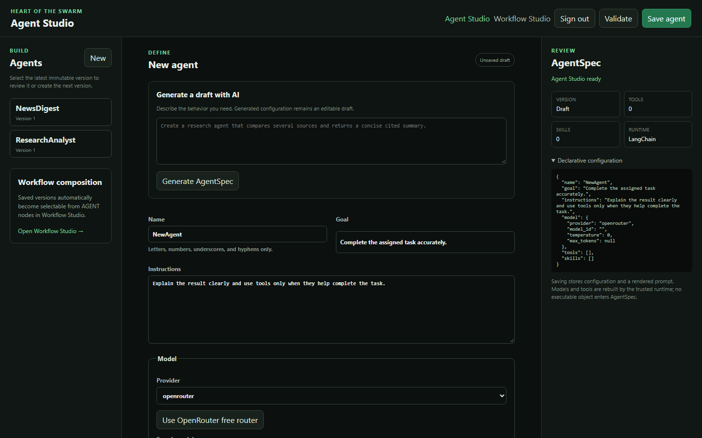
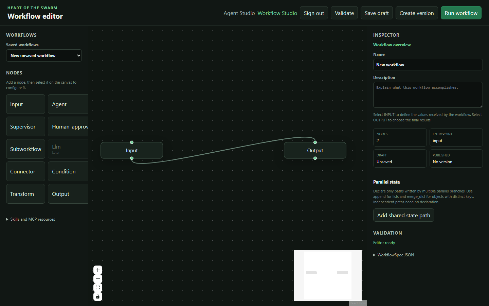

# Read-only sales agent — local end-to-end test result

Test date: 2026-10-12

## Purpose

This test proves that Heart can define an agent, publish an immutable version, run it through the
control plane, export that exact version, and execute it again from an authenticated standalone
Docker runtime. The agent obtains business data through MCP while PostgreSQL remains the final
read-only security boundary.

```text
AgentSpec
→ immutable AgentVersion
→ local Heart run
→ manifest.json + agent.json
→ generic standalone runtime
→ authenticated remote-style invocation
→ MCP tools
→ read-only PostgreSQL
→ result + events + MLflow trace
```

The reproducible declarations and infrastructure are in
[`examples/sales_mcp/`](../../examples/sales_mcp/).

## Result

The complete local path passed.

| Check | Observed result |
| --- | --- |
| Heart API and readiness | HTTP 200 |
| MLflow health | HTTP 200 |
| MCP discovery | Four sales tools discovered |
| Database identity | `heart_sales_reader` |
| Database transaction mode | `transaction_read_only=on` |
| Database write attempt | PostgreSQL rejected `DELETE` |
| Control-plane agent run | Completed |
| Exact-version artifact export | `manifest.json` and `agent.json` |
| Standalone runtime identity | Exact exported version loaded |
| Runtime API authentication | Bearer service token required |
| Standalone invocation | Completed |
| Runtime events | 13 ordered events |
| MLflow trace | `OK`, 10 spans |

## Application surfaces

Agent Studio is used to define, version, test, and export the agent:



Workflow Studio remains available for explicit composition, but it is not required by this test:



## Environment

The Compose stack contained the Heart API and worker, the Heart product database, MLflow, an
isolated `sales_demo` PostgreSQL database, a FastMCP server, and the generic agent runtime.

No credential was stored in `AgentSpec`, `agent.json`, or `manifest.json`. Local passwords and API
tokens were injected through the ignored `.env` file.

## 1. Start Heart, PostgreSQL, and MCP

```bash
docker compose -f compose.yaml -f compose.sales-demo.yaml up --build -d
```

The API, MLflow, demonstration database, and MCP healthchecks all became healthy.

## 2. Exercise the real MCP boundary

The smoke test uses LangChain's MCP adapter and Heart's production
`ToolRegistry.invoke_one()` normalization path:

```bash
uv run --locked python examples/sales_mcp/smoke_test.py
```

Observed catalogue:

```text
database_access
recent_orders
sales_summary
top_products
```

Observed security response:

```json
{
  "database_user": "heart_sales_reader",
  "transaction_read_only": true,
  "may_select_orders": true,
  "may_insert_orders": false,
  "may_update_orders": false,
  "may_delete_orders": false
}
```

The independent database check returned `transaction_read_only=on`. PostgreSQL rejected a
`DELETE` with `cannot execute DELETE in a read-only transaction`. The test used an empty predicate
inside a rolled-back transaction, so it could not mutate data even if a permission were wrong.

## 3. Publish and authorize one exact version

Heart created `SalesAnalyst` version 1 from
[`agent-spec.json`](../../examples/sales_mcp/agent-spec.json):

```text
agent_id         6c34ceec-61be-478b-a1fa-cfe10fef1e3b
agent_version_id 45ff67af-6e52-49f3-bb7f-4b5d9cd30818
version          1
model            apodex/apodex-1.1-mini:free through OpenRouter
```

Declaring tools did not grant permission. The worker loaded an exact capability policy for this
immutable principal and the four `sales__*` capabilities. Everything else remained denied.

## 4. Run the version through Heart

Task:

```text
Summarise revenue over the last 30 days and list the two products generating the most revenue.
Use the database tools and quote the figures exactly.
```

The model selected tools itself; no deterministic pre-fetch occurred:

```text
sales__sales_summary(days=30)
sales__top_products(days=30, limit=2)
```

Both calls completed. The answer reported 5 orders, total revenue of 3,151.00, average order value
of 630.20, AI Workstation at 1,299.00, and Inference Accelerator at 825.00.

```text
run_id   0c79164d-d364-424a-af5b-1035dcef22c3
trace_id 3ac4ef74-1a5f-4545-ad61-66d21751142d
status   completed
```

## 5. Export the same immutable version

The authenticated export endpoint produced:

```text
artifact/
├── manifest.json
└── agent.json
```

The manifest loaded by the standalone runtime confirmed the exact version ID, provider, tool list,
runtime type, and content hash. It contained no database password, provider key, or runtime token.

## 6. Invoke the exported version

The artifact was mounted read-only and the generic runtime was started with:

```bash
docker compose -f compose.yaml -f compose.sales-demo.yaml --profile remote-demo \
  up --build -d sales-agent-runtime
```

The following task was sent directly to port 8080, not through the control-plane run API:

```text
Verify whether your database access can modify orders, then summarise the five latest orders
without inventing data.
```

The agent selected `sales__database_access` and `sales__recent_orders`. It completed run
`f7ee90c7-af95-4e29-8239-d758f13bbcef` and explicitly reported that insert, update, and delete
privileges were unavailable.

The runtime emitted:

```text
01 runtime.queued
02 runtime.started
03 agent.started
04 model.started
05 model.completed
06 tool.started
07 tool.started
08 tool.completed
09 tool.completed
10 model.started
11 model.completed
12 agent.completed
13 runtime.completed
```

This proves that the immutable declaration rebuilds the LangChain agent in another runtime.
Provider credentials, capability policy, MCP configuration, and the service token remain external.

## 7. Verify MLflow

The standalone response returned:

```text
product trace_id  7f054436-e53b-469a-80ef-f23371a21707
MLflow trace_id   tr-fcf5cc2fdfb31553fc0257dbd941762f
```

Reading the trace back from MLflow returned state `OK` and ten spans:

```text
deployed_agent.run
SalesAnalyst
model
ChatOpenAI
tools
tools
sales__database_access
sales__recent_orders
model
ChatOpenAI
```

Open [the local MLflow UI](http://127.0.0.1:5000) and search for the trace ID to inspect the same
trajectory. PostgreSQL stores product lifecycle and correlation IDs; MLflow stores technical spans.

## Security boundaries exercised

```text
Runtime API caller
→ Bearer service token

Immutable AgentVersion
→ exact Heart capability policy

MCP server
→ database URL injected into its container

PostgreSQL
→ reader grants + read-only transaction
```

The LLM received tool schemas and returned data, never the database password or runtime token.

The demo passes the database password through a container environment variable. This is sufficient
for disposable local infrastructure, but a host administrator can inspect container configuration.
A real deployment should use Docker secrets or an external secret store.

## Limits of this result

- Runtime isolation was proven across containers on one Docker host, not yet across two machines.
- Raspberry Pi/ARM64 or VPS portability remains to be tested with this same artifact.
- Runtime run records are in memory and disappear when the container restarts.
- Successive `/invoke` requests are independent; durable conversations are planned later.
- Automated provisioning and deployment registration remain deferred.

## Next reproducible step

Copy this same artifact and generic runtime image to a Raspberry Pi or VPS, inject host-local
secrets, then repeat `/health`, `/metadata`, `/invoke`, event retrieval, and MLflow correlation. Do
not create a new `AgentVersion` for that test.
